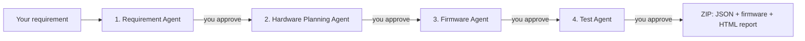

# Prototype Agent

Turn a plain-English idea into an embedded-systems blueprint: **block diagram, I/O list, bill of materials, pin mapping, firmware skeleton and a test plan**, using four cooperating AI agents, with a human approving every stage.

Built for **ESP32**, **Raspberry Pi Pico** and **Arduino Uno**.

> Example input: *"Monitor room temperature, show it on an OLED display, and turn on a fan above 30 degrees."*

## How it works



| Stage | Agent | Output |
|------|-------|--------|
| 1 | Requirement Agent | Project spec, functional requirements, constraints, inputs/outputs, block diagram |
| 2 | Hardware Planning Agent | Components, BOM (approx. cost in INR), pin mapping, power notes, wiring steps |
| 3 | Firmware Agent | Algorithm, libraries, beginner-friendly commented code (Arduino C++ or MicroPython) |
| 4 | Test Agent | Tests with pass criteria (multimeter / serial monitor), power-on checklist |

After each stage you can **Approve** (go to the next agent) or **Reject** with feedback (the agent fixes its answer). Nothing moves forward without your approval, so you stay in control before touching hardware or flashing firmware.

## Features

- Human approval gate at every stage
- Two AI backends: **NVIDIA NIM** (online, free key) or **Ollama** (fully offline)
- Auto-drawn block diagram (Mermaid, bundled, works offline)
- One-click **Download ZIP**: `requirement.json`, `hardware.json`, `firmware.json`, `test_plan.json`, `firmware.ino` / `firmware.py`, `report.html`
- Runs locally on `127.0.0.1`; settings are stored on your own machine
- Can be packaged into a single Windows `.exe`

## Quick start

**Requirements:** Python 3.9+

```bash
git clone https://github.com/DebjitXD/PrototypeAgent.git
cd PrototypeAgent
pip install -r requirements.txt
python app.py
```

Your browser opens automatically.

- **Windows shortcut:** double-click `start_without_building.bat`
- **Linux / macOS shortcut:** `./run.sh`

## Choose an AI backend

Open **Settings** (gear icon) in the app.

### Option A: NVIDIA NIM (online)
1. Create a free API key at [build.nvidia.com](https://build.nvidia.com).
2. Choose **NVIDIA** in Settings, paste the key (`nvapi-...`) and click **Save**.
3. Default model: `deepseek-ai/deepseek-v4.1-flash`. You can change the model ID in Settings if it is unavailable.

You can also set the key as an environment variable instead: `NVIDIA_API_KEY`.

### Option B: Ollama (offline)
1. Install [Ollama](https://ollama.com) and pull a model: `ollama pull qwen2.5:7b`
2. Choose **Ollama** in Settings and enter the model name.

## Using the app

1. Type your requirement and pick a board (ESP32 / Raspberry Pi Pico / Arduino Uno).
2. Click **Start Building**.
3. Review each stage, then **Approve** or **Reject** with feedback.
4. At the end, click **Download ZIP**.
5. Close the app with the red **Quit** button (top right).

## Build the Windows .exe

```bat
build.bat
```

The executable is created at `dist\PrototypeAgent.exe`. If it does not open, remove `--noconsole` from `build.bat`, rebuild, and read the error in the console. Windows antivirus may flag PyInstaller executables; this is a known false positive.

## Project structure

```
PrototypeAgent/
├── app.py                      # Flask backend: prompts, AI calls, ZIP export
├── templates/index.html        # Single-page UI
├── static/mermaid.min.js       # Bundled Mermaid (diagram rendering)
├── requirements.txt
├── build.bat                   # Build the Windows .exe
├── start_without_building.bat  # Run on Windows without building
├── run.sh                      # Run on Linux / macOS
├── LICENSE
└── THIRD_PARTY_NOTICES.md
```

## API endpoints

| Method | Route | Purpose |
|-------|-------|---------|
| GET | `/` | Web UI |
| GET / POST | `/api/settings` | Read / save backend settings (the key is never sent back to the browser) |
| POST | `/api/stage` | Run one agent stage |
| POST | `/api/download` | Build the output ZIP |
| POST | `/api/quit` | Shut down the app |

## Security notes

- Your NVIDIA key is saved in `settings.json` under `%APPDATA%\PrototypeAgent` (Windows) or `~/PrototypeAgent` (other systems), outside this repository.
- Never commit API keys. `.gitignore` already blocks `.env`, `settings.json` and `*.key`.
- AI output can be wrong. **Check pin mappings, voltages and wiring yourself before powering hardware.**

## Limitations

- Output quality depends on the chosen model.
- The AI must return valid JSON; the app retries once, then asks you to press **Retry**.
- It produces a plan and starter firmware, not a verified design.

## Author

**Debjit**, B.Tech ECE, Institute of Engineering & Management (IEM), Kolkata

## License

MIT, see [LICENSE](LICENSE).
